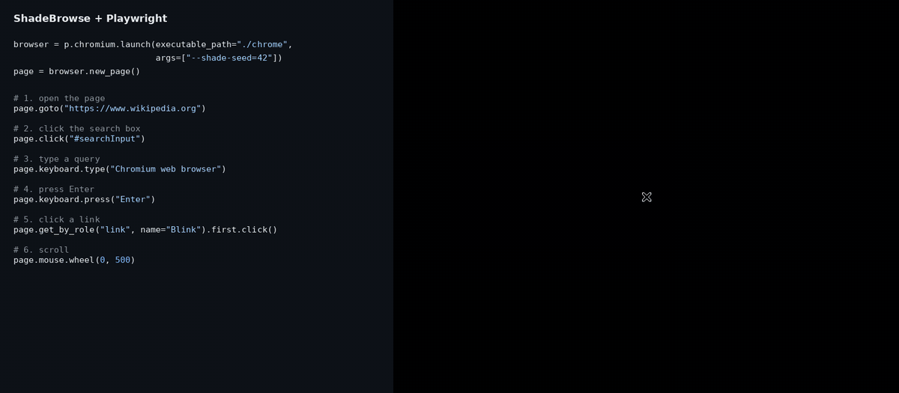
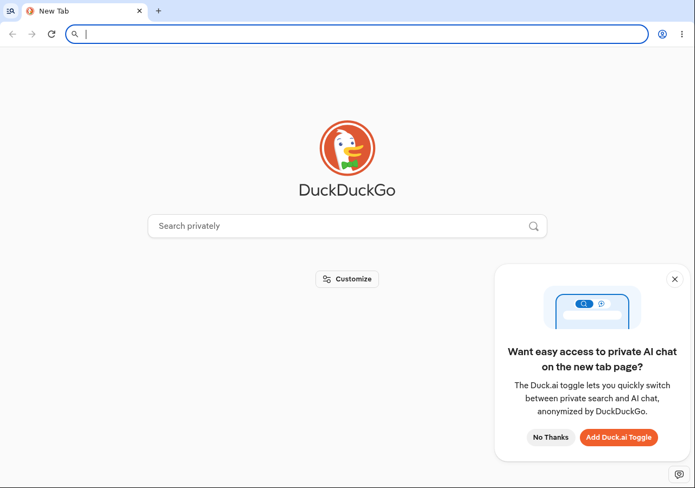
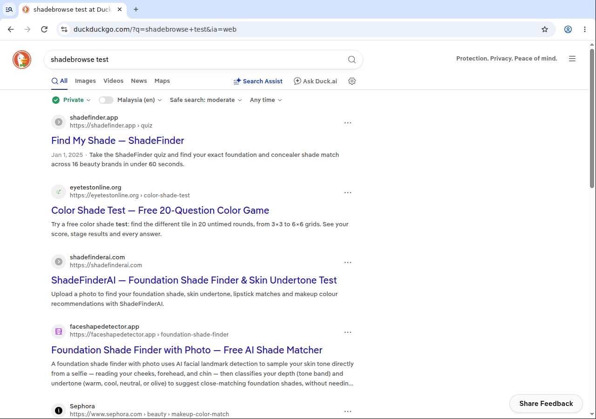
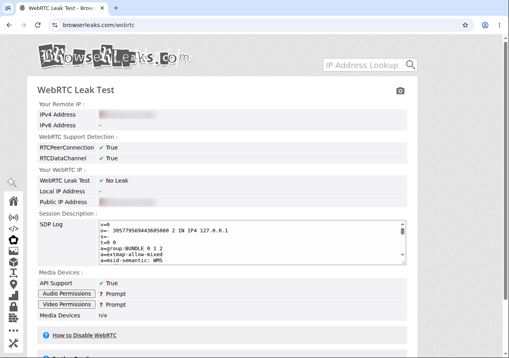
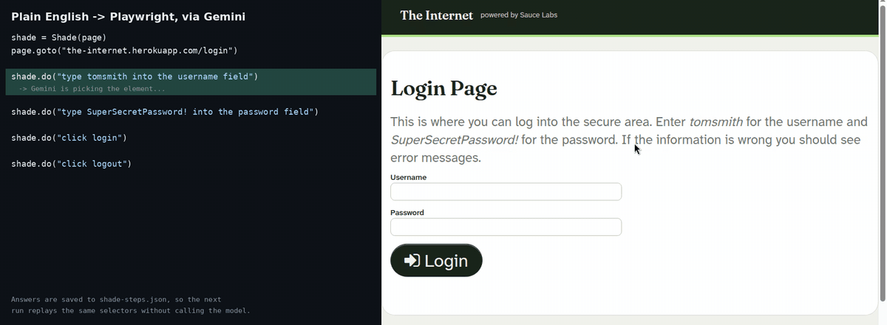
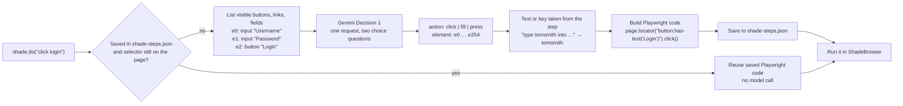
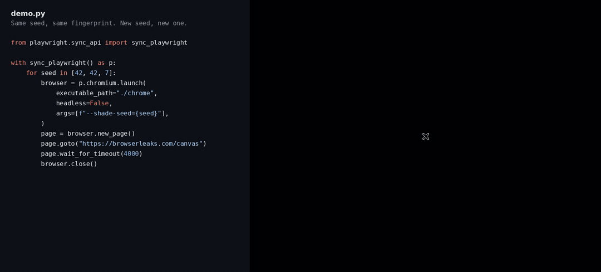
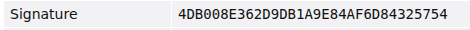
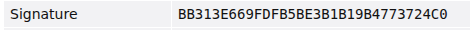
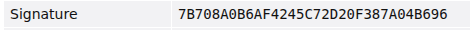

<p align="center">
  
</p>

<h1 align="center">ShadeBrowse</h1>

<p align="center">A Chromium fork where one seed decides how the browser fingerprints and behaves, so the same seed gives the same run.</p>

<p align="center">
  
</p>

<p align="center"><sub>Steps written in plain English. Gemini Decision 1 picks each element and the matching Playwright line appears under the step. Code: <a href="examples/wikipedia.py">examples/wikipedia.py</a>.</sub></p>

---

## What it is

ShadeBrowse is Chromium with a small set of patches to Blink, the browser's rendering engine, and V8, its JavaScript engine. One seed (`--shade-seed=N`) controls:

- **Fingerprint privacy:** small, stable noise in canvas and audio output, plus a believable CPU and memory profile.
- **Reproducibility:** the same seed produces the same fingerprint on every run and every machine with the same build. A different seed produces a different one.
- **Test mode (`--shade-deterministic`):** a fixed starting clock and seeded `Math.random()`, for CI runs and replaying failures.

It's for developers who build scrapers, test suites and browser agents, and who want runs they can reproduce on sites they're allowed to automate.

It keeps the standard Chrome user agent and works with Playwright, Puppeteer and anything else that drives Chrome.

## Quick start

| New tab | Search | WebRTC leak test |
|---|---|---|
|  |  |  |

<sub>The WebRTC screenshot has the server's public IP blurred. "Local IP Address" is empty and the test reports "No Leak".</sub>

```bash
curl -LO https://github.com/naimurhasan/shadebrowse/releases/latest/download/shadebrowse-160.0.8162.0-linux-x64.tar.xz
tar -xJf shadebrowse-160.0.8162.0-linux-x64.tar.xz
cd shadebrowse-160.0.8162.0-linux-x64
./chrome --shade-seed=42
```

| Flag | Effect |
|---|---|
| none | A random seed is picked once per browser session, so all tabs agree with each other. |
| `--shade-seed=N` | A fixed fingerprint for seed `N`. |
| `--shade-seed=off` | Stock Chromium behaviour. |
| `--shade-deterministic` | Test mode: the clock starts at 2025-01-01T00:00Z and `Math.random()` is seeded from the seed. Use it together with `--shade-seed=N`. |

With Playwright:

```js
const browser = await chromium.launch({
  executablePath: "./shadebrowse-160.0.8162.0-linux-x64/chrome",
  args: ["--shade-seed=42"],
});
```

## Plain-English steps with Gemini Decision 1 (optional)

<p align="center">
  
</p>

The [`shadebrowse`](sdk/python) Python helper turns a step written in plain English into one Playwright action, using [Gemini Decision 1](https://blog.google/innovation-and-ai/technology/developers-tools/gemini-decisions-api/). Decision 1 doesn't write text. It picks from options you give it and returns a probability for each one, which suits this job:

1. The helper lists the page's visible buttons, links and fields, up to 255 of them.
2. It asks Decision 1 two multiple-choice questions in one request: which action (click, type or press), and which element.
3. Any text to type or key to press is taken from the step itself, for example `tomsmith` from "type tomsmith into the username field".



```python
from shadebrowse import Shade

shade = Shade(page)
shade.do("type tomsmith into the username field")   # page.locator("#username").fill("tomsmith")
shade.do("click login")                             # page.locator("button:has-text('Login')").click()
```

Each answer is saved to `shade-steps.json`. The next run replays the saved selectors without calling the model, so it behaves like ordinary hand-written code. The model is only asked again when a saved selector no longer matches anything on the page.

- **Key:** set `OPENROUTER_API_KEY` (uses OpenRouter's decisions endpoint) or `GEMINI_API_KEY` (uses Google's Gemini API directly) when you run your script. Neither is needed to build or run the browser.
- **Cost:** Decision 1 costs $0.10 per million input tokens and nothing for output. A test call on OpenRouter cost $0.0000093. Recording both demos took 7 calls; a rerun takes none.
- **Install:** `pip install -e sdk/python`. Examples: [`examples/login.py`](examples/login.py), [`examples/wikipedia.py`](examples/wikipedia.py).

The login demo uses [the-internet.herokuapp.com](https://the-internet.herokuapp.com/login), a public practice site, and its published test login.

## Results

All numbers below come from [`tests/run-fingerprint.sh`](tests/run-fingerprint.sh), run on an Azure VM (4 vCPU, 16 GB RAM, Ubuntu) in headless mode.

### Canvas and audio fingerprints

| Run | `toDataURL` hash | `getImageData` hash | Audio sum |
|---|---|---|---|
| Stock (`--shade-seed=off`) | `295774c7` | `4238bbb4` | `172.67164876164316` |
| Seed 42, run 1 | `a231b859` | `4b390e82` | `172.6716512024068` |
| Seed 42, run 2 | `a231b859` | `4b390e82` | `172.6716512024068` |
| Seed 7 | `d85cecec` | `adb5b4a8` | `172.67164719491848` |

The same seed gives the same values. Different seeds give different values. Reading the same canvas twice in one page also returns the same value, so the noise can't be detected by comparing two reads.

### BrowserLeaks canvas test



Signatures from [browserleaks.com/canvas](https://browserleaks.com/canvas):

| Stock | Seed 42 | Seed 7 |
|---|---|---|
|  |  |  |

Full page: [stock](docs/screenshots/canvas-stock.png), [seed 42](docs/screenshots/canvas-seed42.png), [seed 7](docs/screenshots/canvas-seed7.png).

### Test mode

| Run | `new Date()` | First two `Math.random()` values |
|---|---|---|
| Normal, seed 42 | real time | different on every run |
| `--shade-deterministic`, run 1 | `2025-01-01T00:00` | `0.66899210, 0.00426774` |
| `--shade-deterministic`, run 2 | `2025-01-01T00:00` | `0.66899210, 0.00426774` |

### Hardware profile

The CPU core count is chosen from values at or below the real one. On the 4-core test VM:

| Seed | 1 | 2 | 3 | 4 | 5 | 6 |
|---|---|---|---|---|---|---|
| `navigator.hardwareConcurrency` | 4 | 4 | 2 | 2 | 2 | 4 |

`navigator.deviceMemory` is either the real value or half of it (only when the real value is 4 GB or more).

### Compared with similar projects

Each browser was launched with Playwright in headed mode on a virtual display, on the same VM, and visited each test page once.

| Check | Chromium (Playwright) | ShadeBrowse, seed 42 | Camoufox 0.5.9 | CloakBrowser 0.7.2 |
|---|---|---|---|---|
| `navigator.webdriver` | `true` | `true` | `false` | not tested |
| [deviceandbrowserinfo.com bot check](https://deviceandbrowserinfo.com/are_you_a_bot) | "You are a bot" | "You are a bot" | "You are human" | not tested |
| [bot.sannysoft.com](https://bot.sannysoft.com/) failed rows | 2 | 2 | 1 | not tested |
| BrowserLeaks canvas signature | `4DB008E3…` (fixed) | `BB313E66…` (changes with the seed) | `AE58B835…` | not tested |

**Reading this honestly:** ShadeBrowse is not a stealth browser. It doesn't hide automation, so bot checks flag it exactly as they flag stock Chromium driven by Playwright. Camoufox hides automation and passes these checks. What ShadeBrowse adds is a fingerprint you control with a seed and runs you can reproduce.

CloakBrowser now needs a license key to launch, so it wasn't tested.

Screenshots: [Chromium](docs/compare/chromium-areyouabot.png), [ShadeBrowse](docs/compare/shadebrowse-areyouabot.png), [Camoufox](docs/compare/camoufox-areyouabot.png) on the bot check; [Chromium](docs/compare/chromium-sannysoft.png), [ShadeBrowse](docs/compare/shadebrowse-sannysoft.png), [Camoufox](docs/compare/camoufox-sannysoft.png) on Sannysoft.

### Cost

The noise has to touch the pixels, so canvas reads get slower. Reading a 1024×1024 canvas 20 times with `getImageData`, 5 runs each:

| | Median |
|---|---|
| Stock | 92.8 ms |
| Seed 42 | 179.3 ms |

That works out to about 4.3 ms extra per megapixel read. Pages that don't read canvas pixels aren't affected.

## How it works

There are 10 patches in [`patches/`](patches). The code patches (01–09) add 188 lines to Chromium. Patch 10 renames "Chromium" to "ShadeBrowse" in the interface text.

| Patch | What it changes |
|---|---|
| `01-shade-seed-helper` | A small Blink helper: reads the seed, mixes it with a hash (SplitMix64), and holds the noise functions. |
| `02-canvas-noise` | `getImageData` and `toDataURL`: flips the lowest bit of one colour channel in about 1 in 32 visible pixels. Which pixels are chosen depends on the seed, the pixel's position and its colour, so the same image always gets the same noise. |
| `03-audio-noise` | `OfflineAudioContext`: scales each rendered sample by up to ±0.00005%, once rendering finishes. |
| `04-hardware-profile` | `hardwareConcurrency` and `deviceMemory`: seeded values at or below the real ones. |
| `05-seed-propagation` | The browser passes the seed to every renderer process, generating one per session if none is given, so all tabs and frames agree. |
| `06-deterministic-mode` | Test mode: fixes the wall clock's starting point and sets V8's `--random-seed`. |
| `07-webrtc-hide-local-ip` | WebRTC uses only the public network interface by default, so local IP addresses aren't exposed. |
| `08-duckduckgo-default` | DuckDuckGo is the default search engine, in every region. |
| `09-branding` | Product name. Icons are in [`assets/`](assets). |
| `10-ui-strings` | Interface text says "ShadeBrowse" instead of "Chromium". Copyright lines are unchanged. |

## Build from source

You need Linux x64, about 120 GB of free disk and 16 GB of RAM. A first build takes about 27 hours on 4 cores; after that, small changes take minutes.

```bash
git clone https://github.com/naimurhasan/shadebrowse.git
cd shadebrowse
./scripts/build.sh
./scripts/package.sh
```

Chromium is pinned to the commit in [`CHROMIUM_COMMIT`](CHROMIUM_COMMIT), and the build settings are in [`args.gn`](args.gn).

## Limitations

- **Linux x64 only** for now.
- **Not covered yet:** `canvas.toBlob()`, WebGL `readPixels`, the font list, the screen size and the time zone. The WebGL graphics-card name is left as the real one on purpose.
- **Not a way past bot protection.** Noise makes your browser harder to track across sites; it doesn't make it look human, and test mode is easy to spot. Bot checks flag ShadeBrowse under Playwright just as they flag stock Chromium (see the comparison above). ShadeBrowse doesn't solve CAPTCHAs or challenges.
- **Test mode:** time keeps moving at real speed from the fixed start, so timing-dependent pages can still vary. It also can't be combined with `--virtual-time-budget`.
- **Interface text:** only the English strings are renamed. Other languages fall back to English for renamed messages.
- `crypto.getRandomValues()` is never seeded, because predictable values there would weaken encryption.

## License

Chromium is BSD-licensed; see the [Chromium license](https://chromium.googlesource.com/chromium/src/+/main/LICENSE). ShadeBrowse's patches and scripts use the same license.
